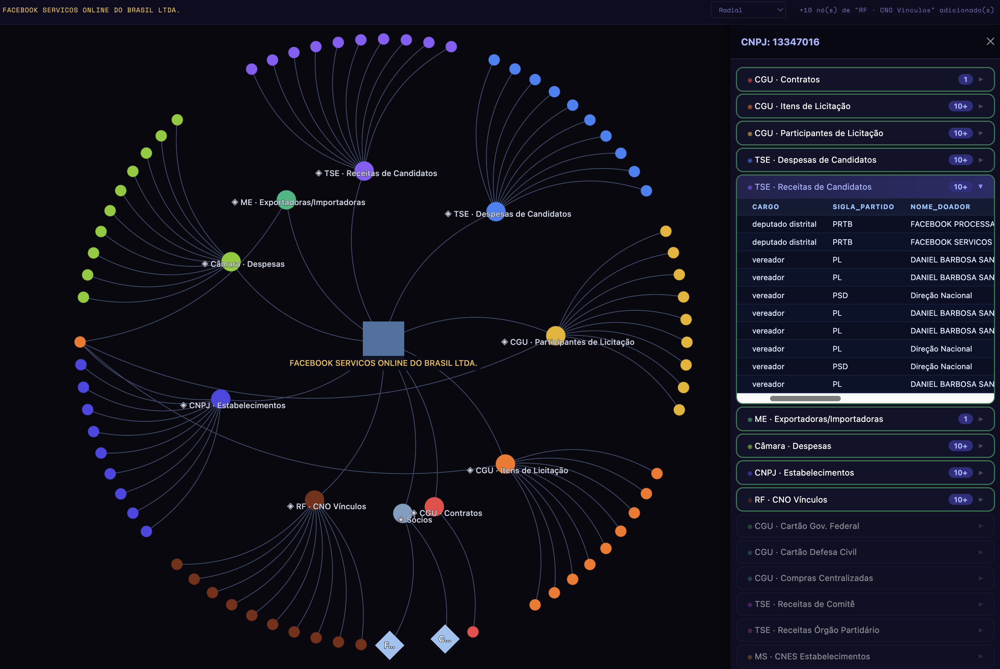

# Datative

  

Datative é um site estático de investigação que mostra as redes das entidades (CNPJ/CPF) com maior abrangência entre datasets publicos federais — Receita Federal, CGU, TSE, SIAFI e mais. Não há consulta ao vivo: todo o grafo de cada entidade é pré-computado offline e servido como JSON estático.

## Principais capacidades

- Landing page lista as 50 empresas e 50 pessoas pré-computadas com maior abrangência (número de datasets distintos em que aparecem, não volume de linhas), em seções separadas.
- Visualização de grafo (empresa/pessoa <-> sócios <-> registros de outros datasets), servida a partir de `static/entities/<id>.json`. Cada dataset com hits vira um nó-hub colorido (ex. "CGU · Contratos") com seus registros pendurados embaixo.
- O grafo em si mostra só uma amostra por dataset (evita virar um emaranhado) — o painel lateral mostra a tabela completa, com todas as linhas, independente do que está visível no grafo.
- Painel lateral (esquerda) com uma seção por dataset (tabela de colunas originais, linha a linha) — clicar no nó-hub de um dataset no grafo foca/expande a seção correspondente. Painel de detalhes do nó selecionado fica à direita.
- Layouts de grafo:
  - `radial`
  - `radial-compact` ("Radial Compacto") — mesmo layout, mas limita quantos registros de cada dataset aparecem no anel (o resto vira um nó "+N mais"), para grafos com muitos hits por dataset
  - `forceatlas2`
  - `collapsible-tree`
  - `pack` (circle packing hierarquico, estilo D3 pack)
- Sem servidor de dados em tempo de request — `src/index.ts` só lê arquivos estáticos.

## Peça a análise de uma nova entidade

O site mostra só as 50 empresas e 50 pessoas com maior abrangência entre datasets — mas você pode pedir que uma entidade específica seja analisada. Para isso, [abra uma issue](https://github.com/rafapolo/datative/issues/new) informando o CNPJ ou CPF (só números) da empresa ou pessoa que você quer ver mapeada, junto com o motivo do interesse. Quando a análise for feita, o grafo dessa entidade é publicado e o link é deixado como comentário na própria issue.

## Datasets consultados

Para cada entidade, o gerador procura correspondências de CNPJ/CPF nas 117 tabelas abaixo (todas do espelho [Base dos Dados](https://basedosdados.org/) em DuckDB). Além delas, `br_me_cnpj.empresas` e `br_me_cnpj.socios` montam a base da rede (empresa ↔ sócios). Tabelas com CPF só entram quando a pessoa aparece em papel de prestação de contas pública (sanções, TSE, TCU, IBAMA, administradores na CVM, fornecedores/beneficiários de recursos públicos) — programas sociais, folha de servidores e filiação partidária ficam de fora de propósito.

| Dataset | Tabela | Colunas de CNPJ/CPF |
|---|---|---|
| CGU · Contratos | `br_cgu_licitacao_contrato.contrato_compra` | `cpf_cnpj_contratado` |
| CGU · Itens de Licitação | `br_cgu_licitacao_contrato.licitacao_item` | `cpf_cnpj_vencedor` |
| CGU · Participantes de Licitação | `br_cgu_licitacao_contrato.licitacao_participante` | `cpf_cnpj_participante` |
| CGU · Cartão Gov. Federal | `br_cgu_cartao_pagamento.microdados_governo_federal` | `cnpj_cpf_favorecido` |
| CGU · Cartão Defesa Civil | `br_cgu_cartao_pagamento.microdados_defesa_civil` | `cnpj_cpf_favorecido` |
| CGU · Compras Centralizadas | `br_cgu_cartao_pagamento.microdados_compras_centralizadas` | `cnpj_cpf_favorecido` |
| TSE · Despesas de Candidatos | `br_tse_eleicoes.despesas_candidato` | `cpf_cnpj_fornecedor`, `cnpj_candidato`, `cnpj_prestador_contas` |
| TSE · Receitas de Candidatos | `br_tse_eleicoes.receitas_candidato` | `cpf_cnpj_doador`, `cnpj_candidato`, `cnpj_prestador_contas` |
| TSE · Receitas de Comitê | `br_tse_eleicoes.receitas_comite` | `cpf_cnpj_doador`, `cnpj_prestador_contas` |
| TSE · Receitas Órgão Partidário | `br_tse_eleicoes.receitas_orgao_partidario` | `cpf_cnpj_doador`, `cnpj_prestador_contas` |
| MS · CNES Estabelecimentos | `br_ms_cnes.estabelecimento` | `cpf_cnpj`, `cnpj_mantenedora` |
| Câmara · Despesas | `br_camara_dados_abertos.despesa` | `cnpj_cpf_fornecedor`, `cpf` |
| Câmara · Contratos | `br_camara_dados_abertos.licitacao_contrato` | `cpf_cnpj_fornecedor` |
| Anatel · Banda Larga Fixa | `br_anatel_banda_larga_fixa.microdados` | `cnpj` |
| ANP · Preços Combustíveis | `br_anp_precos_combustiveis.microdados` | `cnpj_revenda` |
| ANS · Beneficiários | `br_ans_beneficiario.informacao_consolidada` | `cnpj` |
| BCB · ESTBAN Agências | `br_bcb_estban.agencia` | `cnpj_basico`, `cnpj_agencia` |
| BCB · SICOR Operações | `br_bcb_sicor.operacao` | `cnpj_basico_instituicao_financeira`, `cnpj_basico_agente_investimento`, `cnpj_basico_cadastrante` |
| BD · Diretórios Brasil | `br_bd_diretorios_brasil.empresa` | `cnpj_basico` |
| CVM · Administradores PJ | `br_cvm_administradores_carteira.pessoa_juridica` | `cnpj` |
| CVM · Ofertas Públicas | `br_cvm_oferta_publica_distribuicao.dia` | `cnpj_emissor`, `cnpj_lider`, `cnpj_ofertante` |
| INEP · Censo Escolar | `br_inep_censo_escolar.escola` | `cnpj_escola_privada`, `cnpj_mantenedora` |
| TRASE · Soja Crushing | `br_trase_supply_chain.soy_beans_crushing_facilities` | `cnpj` |
| TRASE · Soja Armazenamento | `br_trase_supply_chain.soy_beans_storage_facilities` | `cnpj_cpf` |
| MS · SIH AIHs | `br_ms_sih.aihs_reduzidas` | `cnpj_estabelecimento`, `cnpj_mantenedora` |
| CNPJ · Estabelecimentos | `br_me_cnpj.estabelecimentos` | `cnpj_basico` |
| RF · CNO Obras | `br_rf_cno.microdados` | `id_responsavel` |
| RF · CNO Vínculos | `br_rf_cno.vinculos` | `id_responsavel` |
| MIDES · Itens de Licitação | `world_wb_mides.licitacao_item` | `documento` |
| MIDES · Participantes de Licitação | `world_wb_mides.licitacao_participante` | `documento` |
| BCB · SICOR Cooperados | `br_bcb_sicor.recurso_publico_cooperado` | `cnpj_basico` |
| BCB · SICOR Mutuários | `br_bcb_sicor.recurso_publico_mutuario` | `cnpj_basico`, `cnpj` |
| BCB · SICOR Propriedades Rurais | `br_bcb_sicor.recurso_publico_propriedade` | `cnpj_basico` |
| MS · SIH Serviços Profissionais | `br_ms_sih.servicos_profissionais` | `id_prestador_servico` |
| Holdings · Sócias (quem me possui) | `br_brasilio_holdings.holdings` | `cnpj` |
| Holdings · Participações (o que eu possuo) | `br_brasilio_holdings.holdings` | `cnpj_socia` |
| PGFN · Dívida Ativa | `br_pgfn_dividaativa.divida` | `CPF_CNPJ` |
| TCU · Empresas Inidôneas | `br_tcu_inidoneos.empresas` | `CPF_CNPJ` |
| TCU · Contas Julgadas Irregulares | `br_tcu_inidoneos.resp_contas_julgadas_irregulares` | `CPF_CNPJ` |
| CVM · Fundos de Investimento | `br_cvm_fundos.fundos` | `CNPJ_FUNDO`, `CNPJ_ADMIN`, `CPF_CNPJ_GESTOR`, `CNPJ_AUDITOR`, `CNPJ_CUSTODIANTE`, `CNPJ_CONTROLADOR` |
| SICAF · Fornecedores | `br_comprasgov_sicaf.fornecedores` | `cnpj` |
| BNDES · Operações | `br_bndes_operacoes_contratadas.operacoes_nao_automaticas` | `cnpj_cliente`, `cnpj_instituicao_financeira_credenciada` |
| BCB · Penalidades | `br_bcb_penalidades.penalidades` | `CPF_CNPJ` |
| TCE-RJ · Contratos (Estado) | `br_tce_rj.contratos_estado` | `CPFCNPJ` |
| TCE-RJ · Contratos (Município) | `br_tce_rj.contratos_municipio` | `CNPJCPFContratado` |
| Procon · Reclamações | `br_mjsp_ckan.procon` | `NumeroCNPJ` |
| CGU · CEIS (Inidôneas e Suspensas) | `br_cgu_sancoes.ceis` | `cpf_cnpj_sancionado` |
| CGU · CNEP (Empresas Punidas) | `br_cgu_sancoes.cnep` | `cpf_cnpj_sancionado` |
| CGU · CEPIM (Entidades Impedidas) | `br_cgu_sancoes.cepim` | `cnpj_entidade` |
| CGU · Acordos de Leniência | `br_cgu_sancoes.acordos_leniencia` | `cnpj_sancionado` |
| TCU · Inabilitados p/ Função Pública | `br_tcu_inidoneos.inabilitados_funcao_publica` | `CPF` |
| TCU · Contas Irregulares (Implicação Eleitoral) | `br_tcu_inidoneos.resp_contas_julgadas_irreg_implicacao_eleitoral` | `CPF` |
| MTE · Lista Suja (Trabalho Escravo) | `br_mte_listasuja.empregadores` | `cpf_cnpj` |
| MTE · CEAC (Ajuste de Conduta) | `br_mte_listasuja.ceac` | `cpf_cnpj` |
| IBAMA · Autos de Infração | `br_ibama_autos.auto_infracao` | `cpf_cnpj_infrator` |
| IBAMA · Termos de Embargo | `br_ibama_embargos_novo.termo_embargo` | `cpf_cnpj_embargado` |
| IBAMA · Decisões de Embargo | `br_ibama_embargos_novo.decisao` | `cpf_cnpj_interessado` |
| IBAMA · CTF Atividades Poluidoras | `br_ibama_ctf.app` | `cnpj` |
| IBAMA · CTF Instrumentos de Defesa Ambiental | `br_ibama_ctf.aida` | `cnpj` |
| MGI · Fornecedores | `br_mgi_compras_publicas.fornecedor` | `cnpj` |
| MGI · Itens de Licitação | `br_mgi_compras_publicas.licitacao_item` | `cnpj_fornecedor` |
| MGI · Compras sem Licitação | `br_mgi_compras_publicas.compra_sem_licitacao_item` | `cnpj_vencedor` |
| MGI · Ofertas em Pregão | `br_mgi_compras_publicas.pregao_item_oferta` | `cnpj_cpf_fornecedor` |
| Câmara · Propostas (Fornecedor) | `br_camara_dados_abertos.licitacao_proposta` | `cpf_cnpj_fornecedor` |
| Câmara · Itens Contratados (Fornecedor) | `br_camara_dados_abertos.licitacao_item` | `cpf_cnpj_fornecedor` |
| Senado · CEAPS (Cota Parlamentar) | `br_senado_ceaps.despesas` | `cpf_cnpj_fornecedor` |
| Senado · Contratações | `br_senado_dados_abertos_administrativos.contratacao` | `cpf_cnpj_empresa` |
| Senado · Empresas Cadastradas | `br_senado_dados_abertos_administrativos.empresa` | `cpf_cnpj` |
| TSE · Candidaturas | `br_tse_eleicoes.candidatos` | `cpf` |
| TSE · Pesquisas Eleitorais (Instituto) | `br_tse_eleicoes.pesquisa_eleitoral` | `cnpj_empresa` |
| TSE · Pesquisas Eleitorais (Contratante) | `br_tse_eleicoes.pesquisa_eleitoral_contratante` | `cpf_cnpj_contratante` |
| TSE · Pesquisas Eleitorais (Pagante) | `br_tse_eleicoes.pesquisa_eleitoral_pagante` | `cpf_cnpj_pagante` |
| CVM · Companhias Abertas | `br_cvm_cia_aberta.cadastro` | `CNPJ_CIA`, `CNPJ_AUDITOR` |
| CVM · Acionistas (quem me possui) | `br_cvm_cia_aberta.fre_posicao_acionaria` | `CNPJ_Companhia` |
| CVM · Posições Acionárias (o que eu possuo) | `br_cvm_cia_aberta.fre_posicao_acionaria` | `CPF_CNPJ_Acionista` |
| CVM · Sociedades Participadas | `br_cvm_cia_aberta.fre_participacao_sociedade` | `CNPJ_Companhia` |
| CVM · Participação de Companhias Abertas | `br_cvm_cia_aberta.fre_participacao_sociedade` | `CNPJ` |
| CVM · Auditores | `br_cvm_cia_aberta.fre_auditor` | `CNPJ_Companhia`, `CNPJ_Auditor` |
| CVM · Escrituradores | `br_cvm_cia_aberta.fca_escriturador` | `CNPJ_Companhia`, `CNPJ_Escriturador` |
| CVM · Administradores e Conselho Fiscal | `br_cvm_cia_aberta.fre_administrador_membro_conselho_fiscal` | `CNPJ_Companhia`, `CPF` |
| CVM · Relações Familiares de Administradores | `br_cvm_cia_aberta.fre_relacao_familiar` | `CNPJ_Companhia`, `CPF_Administrador`, `CPF_Pessoa_Relacionada` |
| CVM · Registro de Fundos | `br_cvm_fundos.registro_fundo` | `CNPJ_Fundo`, `CNPJ_Administrador`, `CPF_CNPJ_Gestor` |
| CVM · Classes de Fundos | `br_cvm_fundos.registro_classe` | `CNPJ_Classe`, `CNPJ_Auditor`, `CNPJ_Custodiante`, `CNPJ_Controlador` |
| CVM · Responsáveis de Administradoras | `br_cvm_administradores_carteira.responsavel` | `cnpj` |
| BNDES · Operações Indiretas (Agente) | `br_bndes_operacoes_contratadas.operacoes_indiretas_automaticas` | `cnpj_agente_financeiro` |
| BNDES · Exportação de Bens | `br_bndes_operacoes_contratadas.operacoes_exportacao_bens` | `cnpj_exportador` |
| BNDES · Exportação de Serviços | `br_bndes_operacoes_contratadas.operacoes_exportacao_servicos` | `cnpj_exportador` |
| BCB · IF.data Cadastro | `br_bcb_ifdata.cadastro` | `cnpj_instituicao_lider` |
| BCB · SICOR Instituições | `br_bcb_sicor.instituicao_financeira` | `cnpj_basico` |
| BCB · SICOR Agências | `br_bcb_sicor.recurso_publico_complemento_operacao` | `cnpj_agencia` |
| ANS · Operadoras Ativas | `br_ans_operadoras.operadoras_ativas` | `CNPJ` |
| ANS · Operadoras Canceladas | `br_ans_operadoras.operadoras_canceladas` | `CNPJ` |
| ANS · Penalidades | `br_ans_operadoras.penalidades` | `CNPJ` |
| ANP · Preços de Revenda | `br_anp_combustiveis.precos` | `cnpj` |
| ANVISA · CMED Preços de Medicamentos | `br_anvisa_cmed.precos` | `cnpj` |
| ANEEL · Geração Distribuída | `br_aneel_dadosabertos.empreendimento_geracao_distribuida` | `NumCPFCNPJ`, `NumCNPJDistribuidora` |
| ANEEL · Tarifas Homologadas | `br_aneel_dadosabertos.tarifas_homologadas` | `NumCNPJDistribuidora` |
| ANTT · RNTRC Transportadores | `br_antt_dadosabertos.rntrc` | `cpfcnpjtransportador` |
| ANA · Outorgas de Captação | `br_ana_outorgas.captacoes` | `emp_nu_cpfcnpj` |
| ANA · Outorgas de Lançamento | `br_ana_outorgas.lancamentos` | `emp_nu_cpfcnpj` |
| ANM · CFEM Arrecadação | `br_anm.cfem_cfem_arrecadacao` | `cpf_cnpj` |
| ANM · CFEM Autuações | `br_anm.cfem_cfem_autuacao` | `cpf_cnpj` |
| ANM · Portarias de Lavra | `br_anm.scm_portaria_de_lavra` | `cpf_cnpj_do_titular` |
| ANM · Alvarás de Pesquisa | `br_anm.scm_alvara_de_pesquisa` | `cpf_cnpj_do_titular` |
| ANM · Requerimentos de Pesquisa | `br_anm.scm_requerimento_de_pesquisa` | `cpf_cnpj_do_titular` |
| ANM · Licenciamentos | `br_anm.scm_licenciamento` | `cpf_cnpj_do_titular` |
| Saúde · Banco de Preços (BPS) | `br_saude_bps.dados` | `cnpj_da_instituicao`, `cnpj_do_fornecedor`, `cnpj_do_fabricante` |
| Saúde · Farmácia Popular | `br_saude_farmaciapopular.estabelecimentos` | `numero_cnpj`, `numero_cnpj_entidade` |
| CGU · Terceirizados (Empresa) | `br_cgu_pessoal_executivo_federal.terceirizados` | `cnpj_empresa` |
| CGU · Gás do Povo (Revenda) | `br_cgu_gas_do_povo.gas_do_povo` | `cnpj_estabelecimento` |
| MinC · SALIC (Lei Rouanet) | `br_minc_salic.entidades` | `cnpjcpf` |
| SICONV · Obras (Fornecedor) | `br_transferegov_siconv.siconv_acomp_obras_contratos_medicoes` | `CNPJ_FORNECEDOR_CONTRATO_ACOMPANHAMENTO_OBRA` |
| SICONV · Apoiadores de Emendas | `br_transferegov_siconv.siconv_apoiadores_emendas_programas` | `CNPJ_PROPONENTE_APOIADORES_EMENDAS`, `CNPJ_PJ_SOLICITANTE_APOIADORES_EMENDAS` |
| SICONV · Consórcios | `br_transferegov_siconv.siconv_consorcios` | `CNPJ_CONSORCIO`, `CNPJ_PARTICIPANTE` |
| RF · Fundos Habilitados (Doações DIRPF) | `br_rf_dirpf.fundos_habilitados` | `cnpj_fundo` |
| RAIS · Estabelecimentos Identificados | `br_me_rais_identificada.estabelecimentos` | `cnpj_basico` |
| CNPJ · Simples Nacional / MEI | `br_me_cnpj.simples` | `cnpj_basico` |

## Estrutura de arquivos

- `src/`: servidor + templates + cliente de grafo
- `scripts/`: `generate-static-entities.ts`, `build-site.ts`, `benchmark.ts`, `lib/` (acesso a dados offline)
- `data/`: `schemas.json` (catálogo de tabelas)
- `static/`: saída gerada por `generate-static-entities.ts` (`entities/`, `entities-index.json`) — fonte de dados tanto do servidor de dev quanto do export estático
- `public/`: `graph.js` (bundle gerado a partir de `src/graph-client.ts`) e `favicon.svg`
- `dist/`: saída de `bun run build:site` (gitignored — gerado no CI a cada deploy)
- `tests/`: testes unitários (`bun test`)

## Licenca

Defina aqui a licenca oficial do projeto (ex.: MIT, Apache-2.0, proprietaria).
